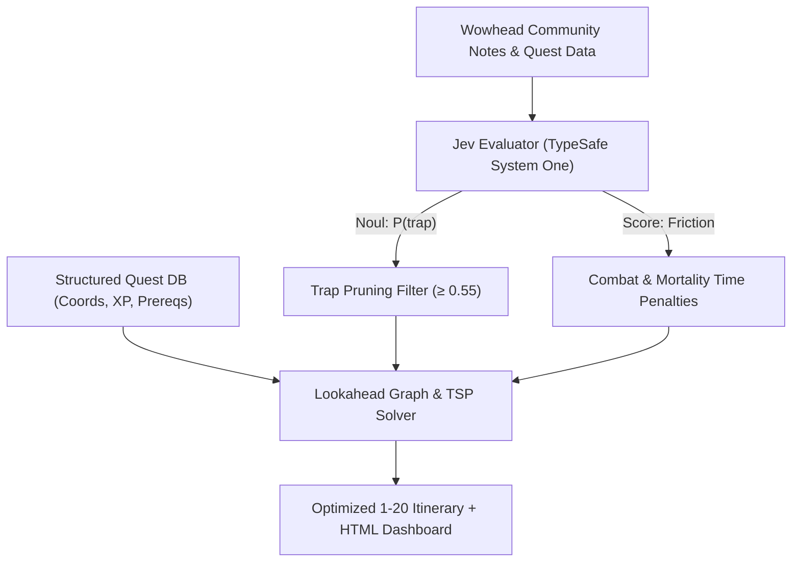

# WoW Classic 1-20 Speedrun Route Optimizer (Mulgore &rarr; The Barrens)

A hybrid speedrun routing engine combining **deterministic graph optimization** with **TypeSafe System One (Jev)** semantic intelligence.

---

## Architecture Overview



### 1. Deterministic Engine (Code owns the graph)
- **XP Progression**: Accurate Classic WoW Level 1-20 XP curve and out-level decay penalties.
- **Physical Kinematics**: Euclidean travel times at 7.0 yd/s (100% running speed) calibrated to Mulgore (38 yd/unit) and The Barrens (65 yd/unit).
- **Spatial TSP**: Dynamic clustering of co-located quests and hub-turnin circuits.
- **Hearthstone & Flight**: Hearthstone cooldown resets (60m) and Thunder Bluff &harr; Crossroads flight paths.

### 2. Semantic Intelligence (Jev owns qualitative common sense)
- **`Noul` (Trap Probability)**: Evaluates player comments to detect low drop rate RNG (<40%), sparse wandering spawns, and slow escorts.
- **`Score` (Combat Friction)**: Discrete continuous score from `trivial` (0.0) to `death_trap` (3.0) applied as time multipliers for combat downtime.

---

## Benchmark Results (Level 1-20 Tauren Hunter)

| Metric | Naive Route (Completionist) | Jev-Optimized Speedrun | Delta |
| :--- | :--- | :--- | :--- |
| **Total Time** | **6.47 hours** (388.4 mins) | **4.64 hours** (278.6 mins) | **&darr; 109.8 mins (28.3% faster)** |
| **XP / Hour** | 24,626 XP/hr | 34,325 XP/hr | **&uarr; +9,699 XP/hr (+39.4%)** |
| **Quests Pruned** | 0 | 8 trap quests | 8 notorious time-sinks eliminated |

### Traps Pruned by Jev:
1. **The Zhevra Hooves** (`Noul: 0.93`): Famously atrocious ~15% drop rate.
2. **Escape from the Silverwing** (`Noul: 0.93`): Slow 50% walk-speed escort with ambushes.
3. **Swoop Hunting** (`Noul: 0.92`): Sparse flying mobs with ~20% gizzard drop rate.
4. **Mazzranache** (`Noul: 0.91`): Requires 4 distinct mob species scattered across Mulgore.
5. **The Raptor Horns** (`Noul: 0.90`): ~18% intact horn drop rate with stacking bleed mobs.
6. **The Demon-Scarred Cloak** (`Noul: 0.90`): 6-8 hr rare roaming spawn.
7. **Miner's Fortune** (`Noul: 0.87`): 10+ minute run to extreme south Barrens through high level mobs.
8. **Serena Bloodfeather** (`Noul: 0.62`, `Score: 2.97`): Level 20 boss with elite guards.

---

## Usage

### Run the Optimizer
```bash
# Default (Level 20 Tauren Hunter)
python tools/wow_speedrun/run_optimizer.py

# Custom class and level target
python tools/wow_speedrun/run_optimizer.py --player-class Warrior --target-level 18

# Adjust trap pruning cutoff
python tools/wow_speedrun/run_optimizer.py --trap-threshold 0.60

# Force re-evaluation with Jev (bypass cache)
python tools/wow_speedrun/run_optimizer.py --force-refresh
```

### View Interactive HTML Dashboard
Open [`wow_speedrun_report.html`](file:///e:/GitHub/g3zcreative/tools/wow_speedrun/wow_speedrun_report.html) in any browser.
